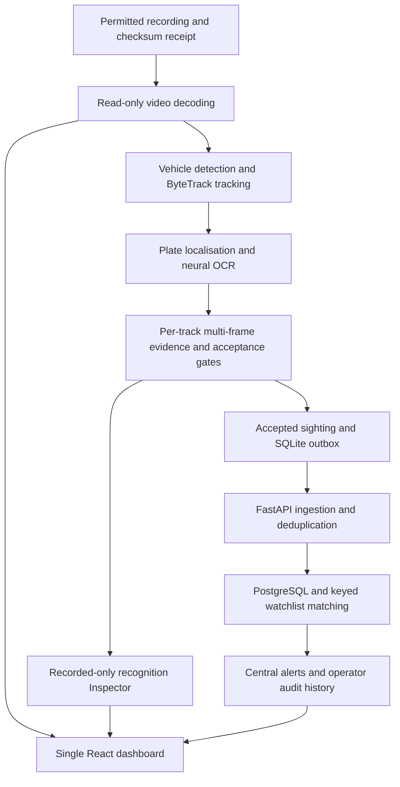
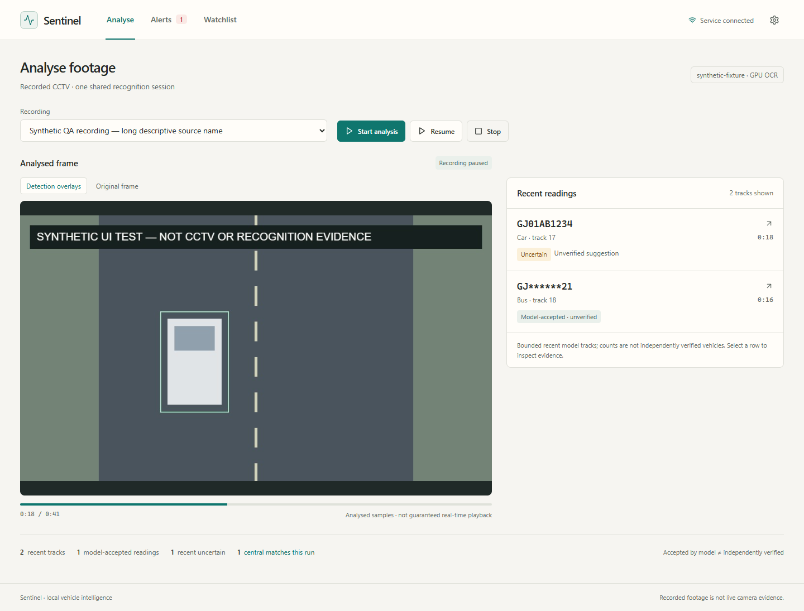
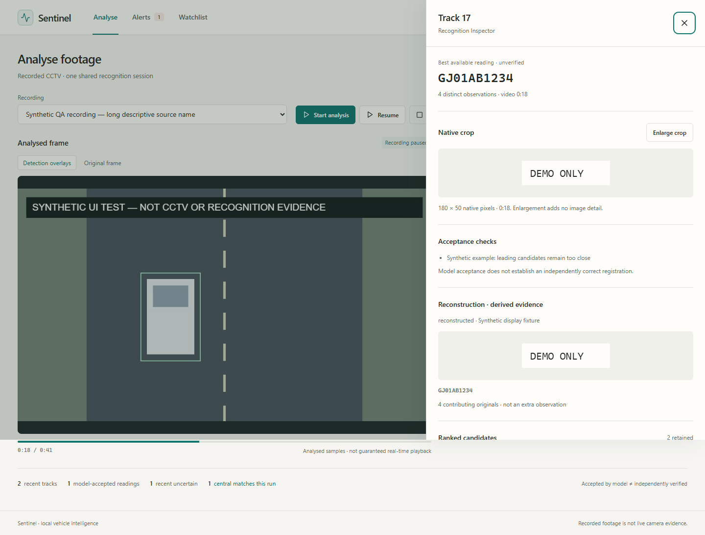
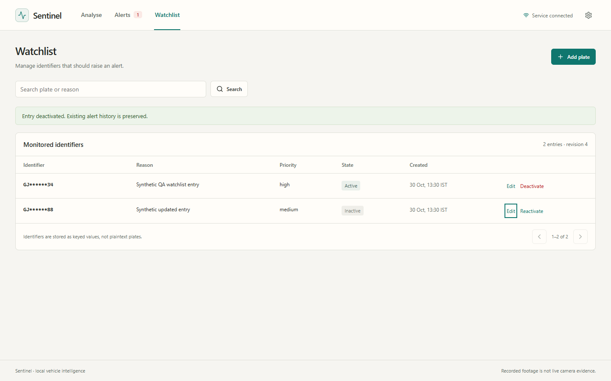

# Sentinel Vehicle Intelligence

Sentinel turns permitted traffic recordings into an inspectable vehicle-analysis workflow: follow a vehicle, examine the plate evidence, and review watchlist alerts in one dashboard.

The current prototype combines **Analyse, Alerts, and Watchlist** with a per-track recognition Inspector. It supports CPU processing and an optional NVIDIA GPU path. Opening the dashboard does not start video analysis; the operator chooses a recording and starts the shared session explicitly.

**Status:** the recorded-video pipeline and unified dashboard are implemented, with documented interface, integration, and runtime checks. Reliable recognition across varied CCTV scenes remains under evaluation. This is a trusted local-computer prototype, not a finished public surveillance service.

## Architecture



The Inspector exposes crops, alternative readings, reconstruction, and acceptance reasons. A model-accepted reading is not independently verified ground truth; an uncertain candidate is not a confirmed central watchlist match. Reconstruction is derived from existing frames, not an additional observation.

## Dashboard



These screenshots show the current interface with **synthetic test fixtures**. The example images, plates, and counts demonstrate the UI, not recognition performance on real footage.

| Area | What the operator can do |
| --- | --- |
| Analyse | Choose a registered recording; explicitly start, pause, resume, or stop analysis; inspect sampled frames and vehicle tracks |
| Recognition Inspector | Examine native crops, per-frame character evidence, ranked alternatives, acceptance reasons, reconstruction, and runtime details |
| Watchlist | Add and search entries; edit reason/severity; deactivate or reactivate entries while preserving alert history |
| Alerts | Review central matches; acknowledge, resolve, or mark a false positive; inspect the action history |

<details>
<summary>More dashboard views: recognition Inspector and Watchlist</summary>

### Per-track evidence



### Watchlist management



</details>

One shared recognition session continues across dashboard navigation. Full image/candidate evidence is opt-in and restricted to permitted recordings. See the [current dashboard guide](docs/UNIFIED_DASHBOARD.md).

## Results and current evidence

| Work | Recorded result | Scope |
| --- | --- | --- |
| Unified dashboard validation, 30 October 2026 | 103 backend tests, 31 frontend tests, 87 focused worker tests, and 15 browser workflow checks passed; one worker test skipped | Interface, access controls, and session behavior; browser checks use synthetic fixtures |
| Bounded CPU/GPU comparison, 15 October 2026 | Three sampled frames took 13.592 seconds on CPU and 4.573 seconds on GPU, a 2.97× aggregate inference speedup | One permitted Polish-plate clip on an RTX 3050 Laptop GPU; not full-video FPS or end-to-end latency |
| Experimental Indian OCR output-layer adaptation | Whole-plate exact reads remained 9/10 before and after adaptation; character errors fell from 2/92 to 1/92 | Ten held-out still-image registrations for this pilot, not general CCTV accuracy |

The completed GPU replay accepted **zero identifiers** on that foreign-plate clip. The OCR pilot's temporal acceptance result also remained unchanged: 13 correct accepts, no wrong accepts, and 8 abstentions across 21 degraded conditions from **one vehicle passage**. These conditions are not 21 independent vehicles.

Sources: [dashboard validation](docs/UNIFIED_DASHBOARD_VALIDATION.md) · [CPU/GPU measurements](docs/RECORDED_GPU_VALIDATION.md) · [OCR adaptation pilot](docs/OCR_FINETUNING.md).

The interface overhaul did not change model weights or acceptance thresholds. Software tests, a running GPU, and model confidence scores do not establish recognition accuracy. Broader independently labelled footage is still needed to measure correct accepts, wrong accepts, abstentions, coverage, and full-video runtime.

## Run the recorded-video dashboard

Requirements: **Git, Windows PowerShell, Docker Desktop with Linux containers/WSL2, and Python 3.11+** for recording registration. Start Docker Desktop first. CPU mode does not require an NVIDIA GPU or Sentinel portal credentials.

### 1. Clone and initialise local settings

```powershell
git clone https://github.com/NithisNandhan/sentinel-vehicle-intelligence-prototype.git
cd sentinel-vehicle-intelligence-prototype
.\scripts\check-prereqs.ps1
.\scripts\init-env.ps1
```

The initialisation script generates local database, service, and HMAC keys in the ignored `.env` file. Keep these keys server-side and preserve an existing `.env`; the browser does not need a manually entered operator key.

### 2. Restore the model/runtime assets on a fresh installation

**A clone does not include the recognition models or prepared OCR runtime.** The recorded worker does not download them automatically. Follow the [handoff asset guide](docs/TEAMMATE_HANDOFF.md) and use the published [handoff release](https://github.com/NithisNandhan/sentinel-vehicle-intelligence-prototype/releases/tag/handoff-2026-10-07).

For the selected restore below, download **every manifest and matching multipart file** for these four bundles into `data/handoff-assets/`:

- `model-cache`
- `alpr-cache`
- `saved-events`
- `presentation-assets`

The restore script requires the last two bundles as well, even when training and benchmark data are skipped. It verifies archive hashes and uses non-overwrite guards. Use a fresh installation; do not apply this restore over an existing populated database. If the model volumes and local configuration are already restored, skip this step.

```powershell
.\scripts\restore-teammate-handoff.ps1 -AssetsPath .\data\handoff-assets -SkipTraining -SkipBenchmarks
```

The restore imports historical metadata into the empty database. Newly generated HMAC keys do not match the archived keyed identifiers: old alerts remain viewable, but new plaintext inputs cannot reproduce those historical identifiers. Add your own permitted test entries for a new run.

The release captures an older system snapshot. Some handoff text and restore completion messages describe the earlier two-interface/unlock workflow; use the single-dashboard instructions below for the current interface.

### 3. Register footage you have permission to use

Place your video in `data/recordings/`, then record its real source and permission basis:

```powershell
python tools/register_recording.py data/recordings/junction.mp4 `
  --source "ACTUAL SOURCE URL OR DESCRIPTION" `
  --licence "ACTUAL LICENCE" `
  --permission "ACTUAL BASIS FOR YOUR PERMISSION" `
  --title "Junction recording"
```

Replace those placeholders with genuine details. The sidecar receipt records a SHA256 checksum. Files without a valid receipt are not offered for analysis, and a changed video is refused. Footage is not bundled with the source repository.

### 4. Start the services and choose a recording

```powershell
# Optional, for transient image/full-candidate inspection of permitted recordings:
$env:DASHBOARD_RECORDED_EVIDENCE = 'true'
.\scripts\start-recorded-analysis.ps1 -Device cpu
```

Open **http://127.0.0.1:5173/**, select your registered recording, and press **Start analysis**. There is no manual unlock step. Omit `-SkipBuild` on the first launch; use it only when the required images are already built.

For a compatible NVIDIA setup, replace `-Device cpu` with `-Device gpu`. GPU mode validates actual model execution before switching the service and refuses unavailable GPU providers. CPU decoding, reconstruction, and other work can still limit overall speed.

Use the dashboard's **Stop** control to end the analysis session. To stop the recorded worker container:

```powershell
docker compose --profile recorded stop recorded-analysis
```

## Tests and verification

The counts above are the archived validation record, not tests rerun by opening this README. For backend and frontend checks on a development machine, use Python 3.11+ and a Node version supported by the frontend tooling; the recorded validation used Node 22.12+ on the 22 LTS line or Node 24 LTS.

From the repository root in PowerShell:

```powershell
python -m venv .venv
.venv/Scripts/python.exe -m pip install -r backend/requirements-dev.txt
$env:PYTEST_DISABLE_PLUGIN_AUTOLOAD = '1'
$env:PYTHONPATH = 'backend'
.venv/Scripts/python.exe -m pytest backend/tests -q -p no:cacheprovider
.venv/Scripts/python.exe tools/generate_unified_contract.py --check
cd frontend
npm ci
npm run build
npm test
```

Worker model checks and browser fixture tests have additional runtime requirements. Their commands, fixtures, skip reason, and deployed-service checks are in [the validation guide](docs/UNIFIED_DASHBOARD_VALIDATION.md). These checks do not require treating model output as ground truth.

## Remaining work

- Evaluate varied, independently labelled recordings with vehicle/scene separation and a frozen held-out split.
- Measure full-video runtime, wrong accepted readings, abstentions, and vehicle/plate coverage; improve the stage supported by that evidence.
- Address the rejected-event retry behavior, which can block the delivery queue when the central API rejects an event.
- Extend recorded-session health reporting and complete a fresh end-to-end release/handoff check.

The current dashboard processes one recording at a time. Maps, route search, regional statistics, and live-catalogue navigation are outside this interface. Historical live-camera adapters remain in the repository but are not part of this quick start. No production-scale or general live-recognition claim is made.

## Privacy and access

Recorded footage stays in the user-managed input directory, mounted read-only. The analysis does not copy or re-encode it to disk. Frames, crops, and full candidates are transient, recorded-only diagnostic evidence; central events use masked plate displays and keyed identifiers. Retention of the original video remains the user's responsibility.

The dashboard uses automatic trusted-local sessions with HTTP-only same-site cookies and CSRF-protected mutations. Keep published ports on loopback. This is not individual-user authentication or a LAN/public deployment configuration.

## Contributions

**Nithis Nandhan E** implemented the majority of the Sentinel project. Collaborative work and changes are retained in the [repository history](https://github.com/NithisNandhan/sentinel-vehicle-intelligence-prototype/commits/main/).

## Repository guide

```text
backend/       FastAPI, database models, watchlist, alerts and local access
edge/          Recorded source, detection, tracking, OCR and delivery outbox
frontend/      React dashboard, shared session controls and Inspector
contracts/     Generated browser types and JSON Schema
scripts/       Environment setup, restore and recorded-worker launch
tools/         Recording registration, evaluation and verification
docs/          Current guides, model experiments and historical reports
```

- **[Unified dashboard](docs/UNIFIED_DASHBOARD.md):** current interface and access behavior.
- **[Recorded footage](docs/RECORDED_VIDEO.md):** receipt format, labels, evaluation, and session semantics. Use the results section above for subsequent recorded measurements.
- **[Dashboard validation](docs/UNIFIED_DASHBOARD_VALIDATION.md):** archived tests and implementation limits.
- **[Model/data audit](docs/DETECTOR_DATASETS.md):** detector sources, licences, and evidence tiers.
- **[RoadText OCR experiment](docs/ROADTEXT_OCR_EXPERIMENT_20261109.md):** dataset-specific fine-tuning, regression results and the review gate before another dataset.
- **[Original versus adapted OCR](docs/OCR_ORIGINAL_VS_ADAPTED_20261109.md):** controlled comparison of the publisher's original weights and our deployed fine-tuning.
- **[Full-video human review](docs/FULL_VIDEO_REVIEW_20261110.md):** label the complete Mumbai clip, merge track fragments, add misses, and calculate an auditable accuracy report.
- **[Temporal OCR comparison](docs/TEMPORAL_APPROACH_COMPARISON_20261110.md):** measured single-frame, multi-frame and reconstruction results, including a verified mixed-vehicle evidence failure.
- **[Evidence continuity and frame selection](docs/FRAME_SELECTION_20261110.md):** deployed guard, full-recording validation and fixed-input image-selection experiments.
- **[Tracking-only prototype](docs/CONTINUOUS_TRACKING_20261110.md):** full-frame GPU runs, tentative-track filtering and local review of non-vehicles and mixed identities.
- **[Owned multi-frame OCR](docs/OWNED_MULTIFRAME_20261110.md):** recognition connected to dense tracks, explicit ownership rejection and paired single/multi-frame results.
- **[Historical engineering validation](VALIDATION.md):** earlier live/diagnostic measurements; these do not define the current dashboard's scope.

Older task reports, `CURRENT_STATUS.md`, handoff notes, and demonstration videos are dated records of earlier iterations. They do not override the current dashboard guide or this recorded-mode setup. Model weights and source datasets retain their respective licences and attribution requirements.

## Tools

Python · PyTorch · PaddlePaddle · ONNX Runtime · OpenCV · Ultralytics/ByteTrack · PyAV/FFmpeg · FastAPI · SQLAlchemy · PostgreSQL/PostGIS · SQLite · React · TypeScript · Vite · Docker
